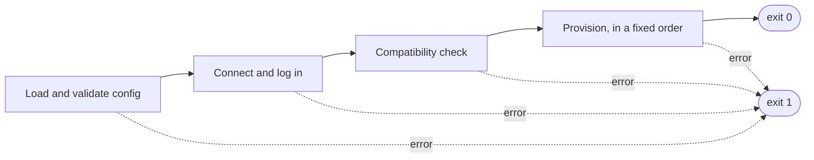

# How it works

The [getting started guide](getting-started.md) showed *what* the provisioner does. This page
explains *how* a run works, so you know what to expect when you rely on it in production:
the order of steps, what `strategy` changes, what is never removed, and how far the
pre-flight check protects you.

## A run, from start to finish

A run has four phases, and only the last one writes to Keycloak:



1. **Load the config.** The YAML file is parsed with a strict decoder, so an unknown field
   is an error. `${VAR}` references are expanded, then the whole config is validated:
   duplicate names, missing required fields, values out of range. **Nothing has been sent
   to Keycloak yet.** What validation can't know is what already exists on the server: a
   user may name a realm role that is neither declared in the file nor present in the realm,
   and that is only found out in step 4.
2. **Connect** and log in as the admin user (`KEYCLOAK_USER`, `KEYCLOAK_PASSWORD`), using the
   password grant of the `admin-cli` client in the `master` realm. Until Keycloak answers,
   the provisioner retries with exponential backoff for up to 5 minutes, so it can start
   alongside Keycloak. [Deployment](deployment.md) has the details.
3. **Check compatibility.** The provisioner reads the server's version, features and
   providers and refuses a config this server can't apply. See
   [The compatibility check](#the-compatibility-check).
4. **Provision** the master realm settings, then each realm in config order. Each step reads
   the current state and creates or updates what the config declares.

The exit code tells you how it ended: `0` on success (and for `--help` and `--version`), `2`
when a flag is misused or `KEYCLOAK_USER` / `KEYCLOAK_PASSWORD` is missing, and `1` for any
failure in the four phases above. A run stops at the first error.

## The provisioning order

Inside a realm, resources are provisioned in this order:

| # | Step | Why here |
|---|---|---|
| — | **Master realm** (`masterRealm`, before any realm): `sslRequired`, then its users | Configures the realm the provisioner itself logs in to. It is never created. |
| 1 | **Realm**: created or updated | Everything else lives in it. |
| 2 | **Authentication flows**, with their executions, subflows and execution config | A client can bind to a flow declared in the same file, and the realm bindings below refer to flows by alias. |
| 3 | **Realm authentication bindings** (`authenticationBindings`) | A second realm update, because the flows have to exist first. |
| 4 | **Client scopes**, their protocol mappers, and their realm-level `type` (default or optional) | A client can attach a scope declared in the same file. |
| 5 | **Clients**, their protocol mappers, client roles, and default and optional client scopes | Client roles must exist before anything is granted them. |
| 6 | **Realm roles** | Before anything that grants them. |
| 7 | **Service account roles**, then **scope mappings** of clients and client scopes | They name realm roles and roles on *any* client, which only all exist after steps 5 and 6. |
| 8 | **Fine-grained management permissions** | A permission grants a scope on one client to another client, and either may be declared later in the file. |
| 9 | **Groups**, their attributes, role mappings and subgroups | After roles, so role mappings resolve. Before users, so users can join them. |
| 10 | **Users**: password, roles, groups, required actions, seeded credentials | After roles and groups exist. |
| 11 | **Identity providers** and their mappers | They refer to flows (first and post broker login), and mappers may name roles and groups. |
| 12 | **Organizations**: domains, members, linked identity providers, organization groups | Last, so members resolve to users and links to identity providers created above. |

Within a step, resources are handled in the order they appear in the file.

The order is what lets one file describe a whole realm: anything a resource refers to has
been created by an earlier step of the same run. The flip side is that a reference to
something the file doesn't declare has to exist in Keycloak already. A user's realm role or
client role that exists in neither place fails the run in step 10; a group that doesn't
exist is logged as a warning (`Group not found, skipping membership`) and skipped.

## Additive by design

The provisioner reconciles what is **in** the config and leaves everything else alone. It
never deletes a realm, client, role, group, user, scope, flow, identity provider or
organization, and never removes a role mapping, group membership or organization member.

| You remove from the config… | What happens in Keycloak |
|---|---|
| a realm, client, role, group, user, … | Nothing. It stays. |
| a role in a user's or group's `roles` | Nothing. The role mapping stays. |
| a group from a user's `groups` | Nothing. The user stays a member. |
| a user from an organization's `members` | Nothing. The user stays a member. |
| a field, such as a client's `redirectUris` | Nothing. The field keeps its current value, because a field you don't declare isn't sent. |
| an attribute key from realm or client `attributes` | Nothing. The key keeps its stored value. |

This is deliberate. A typo or a forgotten line must not delete a client or lock users out in
production. The flip side: the config describes a **minimum**, not the exact state. What an
administrator or another tool adds in Keycloak is left alone, and removing something is a
manual step.

A few settings are **authoritative**: once you declare them, the config is the whole truth
and Keycloak is changed to match.

- **`requiredActions` on a user** replaces the user's list when the user is created or
  updated. `requiredActions: []` clears it. Leave the field out to keep what the user has.
- **An organization's `domains`**, once declared, replace the organization's domain list on
  update. A domain you remove from the list is removed from the organization.
- **Management permission policies.** For each client and scope in `managementPermissions`,
  the provisioner owns one policy, named `keycloak-provisioner.<scope>.<clientId>`, and sets
  its client list to exactly the `clients` you declare. Removing a client from that list
  withdraws its grant on the next run. Removing the whole scope only stops managing it; the
  policy stays.

**Authentication flows are create-only.** A flow whose alias already exists is skipped,
whatever the strategy, and logged as `Skipping existing authentication flow`. Reconciling a
flow would mean diffing an ordered tree of executions that have no stable names and
deleting the ones not in the config. To change a flow the provisioner created, declare it
under a new alias and point the bindings at it.

## Updates send only what you declare

On update, the provisioner sends Keycloak the fields you declared and leaves the others out,
so an undeclared field keeps its value. Where Keycloak would replace a whole structure
rather than patch it, the provisioner reads the current state first and merges the config
over it (Keycloak behaviour, not checked by the provisioner, except where the
[Configuration reference](configuration.md) says it was measured):

| Resource | What is merged, and why |
|---|---|
| Realm, client | `attributes`: Keycloak replaces the whole attribute map on update and keeps several of its own settings there, so the configured keys are merged over the stored ones. |
| Identity provider | The whole representation: Keycloak's update deletes any field or `config` key the request leaves out. The merge keeps a client secret set outside the config, and config keys the provisioner doesn't model. Mapper `config`, by contrast, is replaced from the config. |
| Organization | The whole representation: leaving out `domains` or `redirectUrl` would clear them, and leaving out `alias` is rejected. Attributes merge over the stored ones. |

The same rule decides what a removed field does: it stops being sent, so Keycloak keeps the
last value the provisioner wrote.

## Strategy: `update` or `create`

`strategy` decides what happens to a resource that **already exists**:

- **`update`** (default): send the declared fields, as described above.
- **`create`**: leave the resource's own settings as they are. Missing resources are still
  created.

Set it at the top of the file, and override it per realm:

```yaml
strategy: create          # default for every realm below

realms:
  - realm: <realm>
    strategy: update      # this realm is always reconciled
```

`masterRealm` has no `strategy` of its own; its users follow the top-level one.

`create` is narrower than "don't touch anything that exists". It skips the **update of the
resource itself**: the realm, client, client scope, protocol mapper, role, group, user,
identity provider or organization. Everything attached to an existing resource is still
reconciled. With `strategy: create`, a run still:

- sets each user's `password` (but not `initialPassword`, which is only used on create),
- adds the user's configured roles, groups and missing seeded credentials,
- adds group role mappings and creates missing subgroups,
- applies realm `authenticationBindings`,
- moves a client scope to the realm's default or optional list to match its `type`,
- attaches a client's default and optional client scopes,
- reconciles service account roles, scope mappings and management permissions,
- creates missing identity provider mappers,
- adds organization members, links identity providers and creates organization groups.

You can see it in a run against an existing realm with `strategy: create`:

```json
{"level":"INFO","msg":"Skipping existing realm (strategy=create)","realm":"<realm>"}
{"level":"INFO","msg":"Skipping existing client (strategy=create)","realm":"<realm>","clientId":"shop-api"}
{"level":"INFO","msg":"Skipping existing realm role (strategy=create)","realm":"<realm>","role":"shop-admin"}
{"level":"INFO","msg":"Skipping existing group update (strategy=create)","realm":"<realm>","group":"staff"}
{"level":"INFO","msg":"Skipping existing user (strategy=create)","realm":"<realm>","username":"alice"}
{"level":"INFO","msg":"Setting user password","realm":"<realm>","username":"alice"}
```

Use `create` when the provisioner should set a realm up once and then hand it over, for
example to administrators who tune clients in the admin console. If a user's password must
not be reset afterwards, use `initialPassword` instead of `password`.

## The compatibility check

Before step 4 writes anything, the provisioner compares the config with the server:

- **Version and features.** Organizations, organization groups, standard token exchange,
  client management permissions and step-up authentication need a minimum Keycloak version,
  a server feature, or both. A config that uses one the server lacks is refused. The table
  is in [Deployment](deployment.md).
- **Providers.** Authenticators in flow executions, protocol mapper types, identity provider
  types, identity provider mapper types and users' required actions are checked against what
  the server offers, with a "did you mean" suggestion for a likely typo.

A refused config logs one `Unsupported by this Keycloak server` line per problem, with
`capability`, `reason` and `usedAt`, then `Keycloak compatibility check failed`, and exits
with `1`.

A part of the check the admin account isn't allowed to perform (HTTP 401 or 403) is skipped
with a warning instead of failing the run, for example `Not permitted to read what the server
offers; skipping provider and required action validation`. A version string that can't be
parsed skips the version comparison with a warning. `--skip-version-check` skips the whole
check.

**The check doesn't make a run all-or-nothing.** It catches version, feature and provider
mismatches. Anything else Keycloak rejects, or a reference to something that doesn't exist,
stops the run where it happens, after the earlier steps have already been written. Here a
user names a realm role, `auditor`, that the file doesn't declare and the realm doesn't
have:

```json
{"level":"INFO","msg":"Starting provisioning"}
{"level":"INFO","msg":"Creating realm","realm":"<realm>"}
{"level":"INFO","msg":"Creating client","realm":"<realm>","clientId":"reports"}
{"level":"INFO","msg":"Creating user","realm":"<realm>","username":"bob"}
{"level":"ERROR","msg":"Provisioning failed","error":"provisioning realm \"<realm>\": ensuring user \"bob\": realm role \"auditor\" not found in realm \"<realm>\""}
```

The run exits with `1`, and the realm, the client `reports` and the user `bob` exist. That is
safe to recover from: fix the config and run again. The second run updates what the first
one created and carries on from there. Some names are only checked in the middle of a run:
management permission scope names, for example, are checked in step 8, after steps 1 to 7
have been written.

## Dry-run

`--dry-run` runs the whole sequence against the live server, but each call that would
change something is logged as a `DRY-RUN: would …` line instead of being sent:

```json
{"level":"INFO","msg":"DRY-RUN: would create client","realm":"<realm>","clientId":"shop-api"}
```

Everything before step 4 happens as usual: the provisioner loads the config, connects, logs
in and runs the compatibility check. So a dry run needs the same credentials as a real run,
and fails the same way on a config the server can't apply. Keep in mind:

- **It previews calls, not differences.** Every existing resource the config declares gets a
  `would update` line, whether or not anything would change. You'll also see
  `would reset user password` for every user with a `password`, on every run and with
  either strategy.
- **New resources get stand-in ids.** A realm, client, group or user that would be created
  gets an id starting with `dryrun-`, so the steps that depend on it are still reported in
  the same run.
- **A new flow is only partly shown.** For a flow that would be created, the preview lists
  the flow and its executions, but not their requirements or execution config: those are
  set by reading the created execution back, which can't happen in a dry run.
- **A new client's management permissions** are previewed against a built-in list of scope
  names (`view`, `manage`, `configure`, `map-roles`, `map-roles-client-scope`,
  `map-roles-composite`, `token-exchange`), because there is nothing on the server to read
  yet.

[Preview changes with a dry run](howto/preview-changes-with-dry-run.md) walks through using
it before a deploy.

## Environment variables in the config

A string value may contain `${VAR}`, which is replaced with the environment variable's value
when the config is loaded, before validation. `$${VAR}` gives you the literal text `${VAR}`.
An unset variable is **not** an error: the placeholder stays in the value as literal text,
with no warning, so a missing secret can become a client secret or password of `${VAR}`.
Expansion also covers keys of most maps, but not every field: `strategy`, a client scope's
`type`, `acrLoaMap` keys and management permission scope names are taken as written. The
[Configuration reference](configuration.md) lists exactly what is expanded, and
[Keep secrets out of the config file](howto/keep-secrets-out-of-the-config.md) shows how to
supply the values.

## Next steps

- [Configuration reference](configuration.md) lists every field.
- [Deployment](deployment.md) covers the image, connection retry and the compatibility table.
- [FAQ](faq.md) answers the questions that come up once it runs in production.
