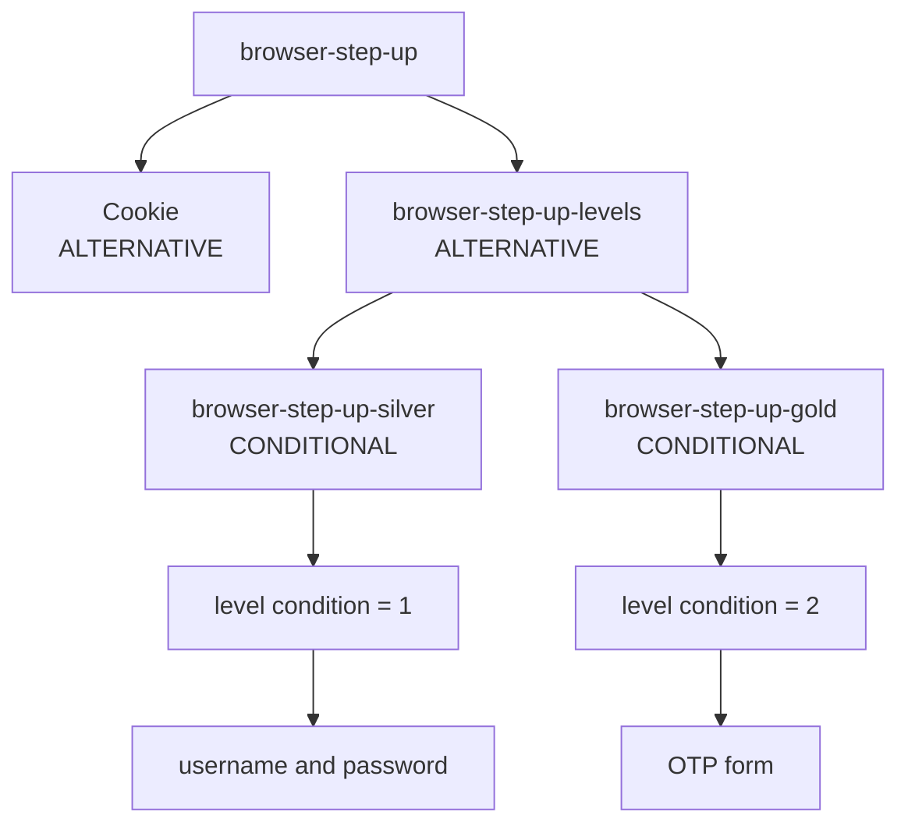

# Add step-up authentication to a client

After this a client signs users in with a password by default and asks for a one-time code
only when the application requests a higher level of authentication.

## When you need this

Most of your web app is fine with a password, but changing payout details should require a
second factor, even for a user who is already signed in. You want Keycloak to ask for the
second factor at that moment and to put the level reached into the token, so the app can check
it. That is step-up authentication: the app asks for a level with the `acr_values` parameter
and Keycloak's browser flow decides what the user has to do to reach it.

## What you need to know first

- **Authentication Context Class Reference (ACR) and Level of Authentication (LoA).** The app
  asks for an ACR name such as `gold`; Keycloak maps it to a numeric level and returns the name
  in the token's `acr` claim. `acrLoaMap` declares that mapping on the realm or the client. See
  [Step-up authentication](https://www.keycloak.org/docs/latest/server_admin/) in the Server
  Administration Guide.
- **`defaultAcrValues`.** The ACR Keycloak uses when a request asks for none. Every value must
  be a key of `acrLoaMap` in the config.
- **Conditional subflow.** A subflow with requirement `CONDITIONAL` runs only when its condition
  holds. The `conditional-level-of-authentication` authenticator is that condition: it holds when
  the requested level equals its `loa-condition-level` (Keycloak behaviour, not checked by the
  provisioner). You put it first inside each level's subflow, followed by what that level
  requires.
- **Flows are create-only.** The provisioner creates a flow with its executions once. When the
  alias exists, it skips the flow, whatever the `strategy`. To change a flow, delete it in
  Keycloak or declare it under a new alias. See [How it works](../concepts.md).
- **Server feature.** Step-up needs `STEP_UP_AUTHENTICATION`, which Keycloak 26.6.4 reports as
  enabled by default. When a config declares `acrLoaMap`, the provisioner refuses to run against
  a server that reports the feature disabled.

This is the flow you build. Cookie and the levels subflow are alternatives: a valid session
cookie satisfies the flow, otherwise the subflow whose level was requested runs.



## Steps

The names `stepup`, `browser-step-up`, `web`, `silver`, `gold` and `bob` are examples;
replace them with your own. The snippets together make `stepup.yaml`.

### 1. Name the levels

`silver` is level 1, `gold` level 2. Declaring the map on the realm makes it apply to every
client; a client can declare its own `acrLoaMap` as well.

```yaml
realms:
  - realm: "stepup"
    enabled: true
    acrLoaMap:
      silver: 1
      gold: 2
```

### 2. Declare the flow

Build the flow from scratch rather than with `copyFrom: "browser"`. Executions you declare under
`copyFrom` are appended at the top level, after the copied ones, and a `CONDITIONAL` subflow
there does not work as a step: on 26.6.4 a client bound to such a flow showed the error page
`Invalid username or password.` on the very first request of every login.

Each subflow alias must be unique in the realm. `alias` inside `config` names the
authenticator configuration; `loa-max-age` is how many seconds a level stays valid before
Keycloak asks for it again (Keycloak behaviour, not checked by the provisioner).

```yaml
    authenticationFlows:
      - alias: "browser-step-up"
        description: "Browser login with a second factor for gold"
        executions:
          - provider: "auth-cookie"
            requirement: "ALTERNATIVE"
          - subflow: "browser-step-up-levels"
            requirement: "ALTERNATIVE"
            executions:
              - subflow: "browser-step-up-silver"
                requirement: "CONDITIONAL"
                executions:
                  - provider: "conditional-level-of-authentication"
                    requirement: "REQUIRED"
                    config:
                      alias: "silver-condition"
                      loa-condition-level: "1"
                      loa-max-age: "36000"
                  - provider: "auth-username-password-form"
                    requirement: "REQUIRED"
              - subflow: "browser-step-up-gold"
                requirement: "CONDITIONAL"
                executions:
                  - provider: "conditional-level-of-authentication"
                    requirement: "REQUIRED"
                    config:
                      alias: "gold-condition"
                      loa-condition-level: "2"
                      loa-max-age: "300"
                  - provider: "auth-otp-form"
                    requirement: "REQUIRED"
```

Executions are created in the order declared. The provisioner checks authenticator names
against what the server offers before it writes anything, unless the admin account may not read
that list.

### 3. Bind the flow to the client

`authenticationFlowBindingOverrides` replaces the realm's browser flow for this client only;
the provisioner resolves the alias to the flow's id. `defaultAcrValues` makes a login without
`acr_values` ask for `silver`.

```yaml
    clients:
      - clientId: "web"
        publicClient: false
        secret: "${WEB_CLIENT_SECRET}"
        redirectUris:
          - "http://localhost:3000/*"
        defaultAcrValues:
          - "silver"
        authenticationFlowBindingOverrides:
          browser: "browser-step-up"
```

To use the flow for every client in the realm instead, bind it on the realm with
`authenticationBindings: {browserFlow: "browser-step-up"}`.

### 4. Give users a second factor

Users who should reach `gold` need a one-time password (OTP) credential. Here `bob` gets one
seeded from the config; see [Require or seed TOTP for users](require-totp-for-users.md) for the
details and the alternatives.

```yaml
    users:
      - username: "bob"
        enabled: true
        password: "${BOB_PASSWORD}"
        email: "bob@example.com"
        emailVerified: true
        firstName: "Bob"
        lastName: "Example"
        credentials:
          - type: "otp"
            label: "authenticator"
            secret: "${BOB_TOTP_SECRET}"
```

### 5. Run the provisioner

```console
$ WEB_CLIENT_SECRET=… BOB_PASSWORD=… BOB_TOTP_SECRET=… \
  KEYCLOAK_URL=http://localhost:8080 KEYCLOAK_USER=admin KEYCLOAK_PASSWORD=… \
  keycloak-provisioner --config stepup.yaml
…
{"time":"…","level":"INFO","msg":"Creating realm","realm":"stepup"}
{"time":"…","level":"INFO","msg":"Creating authentication flow","realm":"stepup","flow":"browser-step-up"}
{"time":"…","level":"INFO","msg":"Adding authentication execution","realm":"stepup","flow":"browser-step-up","provider":"auth-cookie"}
{"time":"…","level":"INFO","msg":"Setting execution requirement","realm":"stepup","flow":"browser-step-up","execution":"auth-cookie","requirement":"ALTERNATIVE"}
{"time":"…","level":"INFO","msg":"Adding authentication subflow","realm":"stepup","flow":"browser-step-up","subflow":"browser-step-up-levels"}
…
{"time":"…","level":"INFO","msg":"Adding authentication subflow","realm":"stepup","flow":"browser-step-up-levels","subflow":"browser-step-up-gold"}
{"time":"…","level":"INFO","msg":"Setting execution requirement","realm":"stepup","flow":"browser-step-up-levels","execution":"browser-step-up-gold","requirement":"CONDITIONAL"}
{"time":"…","level":"INFO","msg":"Adding authentication execution","realm":"stepup","flow":"browser-step-up-gold","provider":"conditional-level-of-authentication"}
{"time":"…","level":"INFO","msg":"Setting execution requirement","realm":"stepup","flow":"browser-step-up-gold","execution":"conditional-level-of-authentication","requirement":"REQUIRED"}
{"time":"…","level":"INFO","msg":"Setting execution config","realm":"stepup","flow":"browser-step-up-gold","execution":"conditional-level-of-authentication","configAlias":"gold-condition"}
{"time":"…","level":"INFO","msg":"Adding authentication execution","realm":"stepup","flow":"browser-step-up-gold","provider":"auth-otp-form"}
{"time":"…","level":"INFO","msg":"Setting execution requirement","realm":"stepup","flow":"browser-step-up-gold","execution":"auth-otp-form","requirement":"REQUIRED"}
{"time":"…","level":"INFO","msg":"Creating client","realm":"stepup","clientId":"web"}
{"time":"…","level":"INFO","msg":"Creating user","realm":"stepup","username":"bob"}
{"time":"…","level":"INFO","msg":"Setting user password","realm":"stepup","username":"bob"}
{"time":"…","level":"INFO","msg":"Seeding user credential","realm":"stepup","username":"bob","type":"otp","label":"authenticator"}
{"time":"…","level":"INFO","msg":"Provisioning complete"}
{"time":"…","level":"INFO","msg":"keycloak-provisioner finished successfully"}
```

## Check that it works

First check the structure through the admin API (`$ADMIN_TOKEN` is an admin access token).
Level 0 is the top of the flow:

```console
$ curl -s -H "Authorization: Bearer $ADMIN_TOKEN" \
    http://localhost:8080/admin/realms/stepup/authentication/flows/browser-step-up/executions \
    | jq -r '.[] | "\(.level) \(.displayName) \(.requirement)"'
0 Cookie ALTERNATIVE
0 browser-step-up-levels ALTERNATIVE
1 browser-step-up-silver CONDITIONAL
2 Condition - Level of Authentication REQUIRED
2 Username Password Form REQUIRED
1 browser-step-up-gold CONDITIONAL
2 Condition - Level of Authentication REQUIRED
2 OTP Form REQUIRED
```

The client stores the flow's id, not its alias, and the default ACR as an attribute:

```console
$ curl -s -H "Authorization: Bearer $ADMIN_TOKEN" \
    "http://localhost:8080/admin/realms/stepup/clients?clientId=web" \
    | jq '.[0] | {authenticationFlowBindingOverrides, defaultAcr: .attributes["default.acr.values"]}'
{
  "authenticationFlowBindingOverrides": {
    "browser": "af7bf5be-bfa8-4f04-9afa-881a69ea2d12"
  },
  "defaultAcr": "silver"
}
```

Then sign in through a browser at
`http://localhost:8080/realms/stepup/protocol/openid-connect/auth?client_id=web&response_type=code&scope=openid&redirect_uri=http://localhost:3000/cb`,
once without and once with `&acr_values=gold`, and decode the `id_token` you get for the code.
These are the results observed on 26.6.4 (2026-11-15), driving the login pages over HTTP rather
than with a browser:

| Request | Pages shown | `acr` in the ID token |
|---|---|---|
| no `acr_values`, new session | password | `silver` |
| `acr_values=gold`, same session | OTP | `gold` |
| `acr_values=gold` again within 300 seconds | none | `gold` |
| `acr_values=gold`, new session | password, then OTP | `gold` |

## Pitfalls

- **Editing the flow in the config changes nothing.** A second run logs
  `{"level":"INFO","msg":"Skipping existing authentication flow","realm":"stepup","flow":"browser-step-up"}`
  and leaves the flow as it is. Declare a new alias, or delete the flow in Keycloak first.
- **Built-in flows are refused.** Declaring the alias `browser` fails the run:

  ```
  {"time":"…","level":"ERROR","msg":"Provisioning failed","error":"provisioning realm \"stepup\": ensuring authentication flow \"browser\": authentication flow \"browser\" is a built-in Keycloak flow and will not be modified; declare your own flow under a new alias and bind it (copyFrom: \"browser\" gives an exact copy, but don't add REQUIRED or CONDITIONAL steps to a copy: Keycloak then skips its login steps)"}
  ```

  For step-up, build the flow from scratch as in step 2, as the message warns.
- **A default ACR that is not in the map is rejected at load.** The check uses the `acrLoaMap`
  declared in the config: the client's own map when it has one, otherwise the realm's:

  ```
  {"time":"…","level":"ERROR","msg":"Failed to load configuration","error":"validating config: realms[0].clients[0].defaultAcrValues[0]: \"platinum\" is not in the acrLoaMap; the config declares gold, silver"}
  ```

  When the config declares no map at all, the check is skipped.
- **The feature check depends on `acrLoaMap`.** The provisioner checks `STEP_UP_AUTHENTICATION`
  only for a realm or client that declares `acrLoaMap`. A flow using
  `conditional-level-of-authentication` without a map in the config is checked only for the
  authenticator's name.
- **A binding override names an alias that must exist.** An alias in
  `authenticationFlowBindingOverrides` that does not resolve fails the run with
  `client "<clientId>": authentication flow "<alias>" not found in realm "<realm>"`. Only the
  keys `browser` and `direct_grant` are accepted.

## Further reading

- [Configuration reference](../configuration.md) for `authenticationFlows`,
  `authenticationBindings`, `acrLoaMap` and `defaultAcrValues`.
- [Require or seed TOTP for users](require-totp-for-users.md).
- [Server Administration Guide](https://www.keycloak.org/docs/latest/server_admin/), sections on
  authentication flows and step-up authentication.
