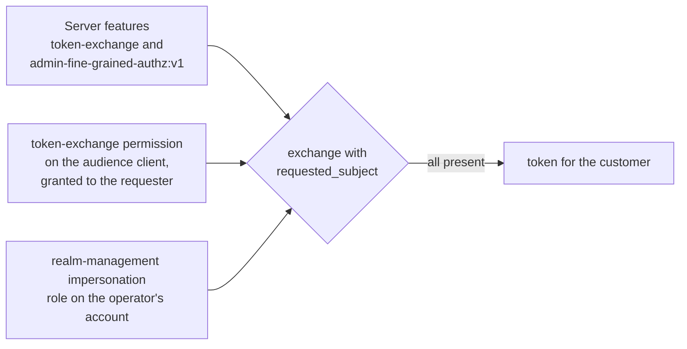

# Allow a client to impersonate users

After this a support tool can exchange an operator's token for a token that acts as a
customer, and you can tell the two ways the exchange is refused apart.

## When you need this

A support console lets an operator see the orders API exactly as a customer sees it. The
console needs a token whose subject is the customer, obtained under the operator's own login,
so that Keycloak records who did it. Keycloak offers this through the legacy (v1) token
exchange with the `requested_subject` parameter, and the permission behind it can only be set
through the admin API. `managementPermissions` lets you declare that permission in the config,
so the realm can be rebuilt without a manual step after every run.

Everything below was run against Keycloak 26.6.4 on 2026-11-15, started with
`start-dev --features=token-exchange,admin-fine-grained-authz:v1`.

## What you need to know first

- **Legacy token exchange (v1).** Keycloak's older, non-standard token exchange. It accepts
  `requested_subject`, which [standard token exchange](set-up-token-exchange.md) does not
  support (Keycloak behaviour, not checked by the provisioner). It is the server feature
  `token-exchange` (reported as `TOKEN_EXCHANGE`, type `PREVIEW`).
- **Fine-grained admin permissions (v1).** Per-client permissions such as `token-exchange`,
  stored as policies on the realm's `realm-management` client. They need the server feature
  `admin-fine-grained-authz:v1` (`ADMIN_FINE_GRAINED_AUTHZ`). With it on, 26.6.4 reports the
  newer `ADMIN_FINE_GRAINED_AUTHZ_V2` as disabled: enabling v1 switches the v2 model off for
  every realm on the server.
- **Both features are deprecated.** At startup Keycloak 26.6.4 logs
  `Deprecated features enabled: admin-fine-grained-authz:v1, token-exchange:v1`. Enabling them
  is a server-wide decision for whoever runs Keycloak, not a per-realm setting.
- **`managementPermissions`.** Declares v1 permissions on a client: for each scope, the clients
  allowed to use it. The provisioner owns one policy per client and scope, named
  `keycloak-provisioner.<scope>.<clientId>`, and replaces its client list on every run. See
  [Configuration reference](../configuration.md).

An impersonation exchange needs three things. Missing any one of them, Keycloak refuses:



## Steps

The names `impersonation`, `orders-api`, `support-console`, `bob` (the operator) and `alice`
(the customer) are examples; replace them with your own. The snippets together make
`impersonation.yaml`.

### 1. Turn on both server features

This is a change to how Keycloak starts, so agree it with whoever runs the server:

```
--features=token-exchange,admin-fine-grained-authz:v1
```

The provisioner checks `admin-fine-grained-authz:v1` before writing anything. If the server
reports it as disabled, the run stops with
`requires the ADMIN_FINE_GRAINED_AUTHZ server feature, which is disabled on this server; start Keycloak with --features=admin-fine-grained-authz:v1`.
It does not check the `token-exchange` feature.

### 2. Grant the requesting client the `token-exchange` permission on the audience client

The permission goes on the client being exchanged **to** (`orders-api`), and names the client
that asks (`support-console`):

```yaml
realms:
  - realm: "impersonation"
    enabled: true
    clients:
      - clientId: "orders-api"
        publicClient: false
        secret: "${ORDERS_API_SECRET}"
        managementPermissions:
          scopes:
            token-exchange:
              clients: ["support-console"]
      - clientId: "support-console"
        publicClient: false
        secret: "${SUPPORT_CONSOLE_SECRET}"
        directAccessGrantsEnabled: true   # only so the check below can get a token with curl
```

The provisioner applies permissions after every client in the realm exists, so the order of
the two clients does not matter.

### 3. Give the operator the `impersonation` role

Keycloak checks the identity in the subject token, here the operator `bob`, so the role goes
on his account, not on the console's service account. The role belongs to the built-in
`realm-management` client, which every realm has.

```yaml
    users:
      - username: "bob"
        enabled: true
        password: "${BOB_PASSWORD}"
        email: "bob@example.com"
        emailVerified: true
        firstName: "Bob"
        lastName: "Operator"
        roles:
          clients:
            realm-management:
              - "impersonation"
      - username: "alice"
        enabled: true
        email: "alice@example.com"
        emailVerified: true
        firstName: "Alice"
        lastName: "Customer"
```

`realm-management`'s `impersonation` role also lets its holder impersonate users through the
admin console and API (Keycloak behaviour, not checked by the provisioner). Grant it as a real
privilege, to the people who need it.

### 4. Run the provisioner

```console
$ ORDERS_API_SECRET=… SUPPORT_CONSOLE_SECRET=… BOB_PASSWORD=… \
  KEYCLOAK_URL=http://localhost:8080 KEYCLOAK_USER=admin KEYCLOAK_PASSWORD=… \
  keycloak-provisioner --config impersonation.yaml
…
{"time":"…","level":"INFO","msg":"Detected Keycloak version","version":"26.6.4"}
{"time":"…","level":"INFO","msg":"Starting provisioning"}
{"time":"…","level":"INFO","msg":"Creating realm","realm":"impersonation"}
{"time":"…","level":"INFO","msg":"Creating client","realm":"impersonation","clientId":"orders-api"}
{"time":"…","level":"INFO","msg":"Creating client","realm":"impersonation","clientId":"support-console"}
{"time":"…","level":"INFO","msg":"Enabling fine-grained management permissions","realm":"impersonation","clientId":"orders-api"}
{"time":"…","level":"INFO","msg":"Creating management permission policy","realm":"impersonation","clientId":"orders-api","scope":"token-exchange","policy":"keycloak-provisioner.token-exchange.orders-api","granted":"support-console"}
{"time":"…","level":"INFO","msg":"Attaching management permission policy","realm":"impersonation","clientId":"orders-api","scope":"token-exchange","policy":"8666d80d-6729-43f2-8576-92315a123611"}
{"time":"…","level":"INFO","msg":"Creating user","realm":"impersonation","username":"bob"}
{"time":"…","level":"INFO","msg":"Setting user password","realm":"impersonation","username":"bob"}
{"time":"…","level":"INFO","msg":"Assigning client roles","realm":"impersonation","subject":"users","subjectName":"bob","client":"realm-management","count":1}
{"time":"…","level":"INFO","msg":"Creating user","realm":"impersonation","username":"alice"}
{"time":"…","level":"INFO","msg":"Provisioning complete"}
{"time":"…","level":"INFO","msg":"keycloak-provisioner finished successfully"}
```

## Check that it works

Run these against a test realm. Get a token for the operator, then exchange it for a token
that acts as alice, addressed to `orders-api`. `requested_token_type` asks for an access token
only; without it, 26.6.4 answered with `issued_token_type` `…:refresh_token` and a refresh
token alongside.

```console
$ KC=http://localhost:8080/realms/impersonation/protocol/openid-connect/token
$ SUBJECT=$(curl -s $KC -d grant_type=password -d client_id=support-console \
    -d client_secret=$SUPPORT_CONSOLE_SECRET -d username=bob -d password=$BOB_PASSWORD \
    | jq -r .access_token)
$ curl -s $KC \
    -d grant_type=urn:ietf:params:oauth:grant-type:token-exchange \
    -d client_id=support-console -d client_secret=$SUPPORT_CONSOLE_SECRET \
    --data-urlencode subject_token=$SUBJECT \
    -d subject_token_type=urn:ietf:params:oauth:token-type:access_token \
    -d requested_subject=alice -d audience=orders-api \
    -d requested_token_type=urn:ietf:params:oauth:token-type:access_token \
    | tee impersonated.json | jq 'del(.access_token)'
{
  "expires_in": 300,
  "refresh_expires_in": 0,
  "token_type": "Bearer",
  "not-before-policy": 0,
  "session_state": "R2ZnyHAj85lGcw5vGpeWLCsZ",
  "scope": "email profile",
  "issued_token_type": "urn:ietf:params:oauth:token-type:access_token"
}
$ jq -r .access_token impersonated.json | cut -d. -f2 | tr '_-' '/+' | base64 -d 2>/dev/null \
    | jq '{sub, aud, azp, preferred_username}'
{
  "sub": "0b279fd3-f0b9-4655-8f36-fd4141cacd21",
  "aud": [
    "account",
    "orders-api"
  ],
  "azp": "support-console",
  "preferred_username": "alice"
}
```

`sub` is alice's user id, not bob's: the token acts as the customer.

To see the permission the provisioner wrote, read `orders-api`'s management permissions in the
admin API (`<orders-api-uuid>` is the client's internal id). `token-exchange` is among the
scopes:

```console
$ curl -s -H "Authorization: Bearer $ADMIN_TOKEN" \
    http://localhost:8080/admin/realms/impersonation/clients/<orders-api-uuid>/management/permissions
{
  "enabled": true,
  "resource": "41450d64-…",
  "scopePermissions": {
    "view": "6bd5c94e-…",
    "manage": "fb3f16d3-…",
    "configure": "6eccf18d-…",
    "map-roles": "210bcc8d-…",
    "map-roles-client-scope": "82ecf3cc-…",
    "map-roles-composite": "c65622c9-…",
    "token-exchange": "32064b95-…"
  }
}
```

### Telling the failures apart

With both features on, a missing grant gives the same answer whichever grant it is. Both of
these were captured on 26.6.4:

| What is missing | Response |
|---|---|
| `impersonation` on the operator's account (removed in Keycloak, then the exchange repeated) | `{"error":"access_denied","error_description":"Client not allowed to exchange"}` |
| `token-exchange` permission on the audience client (exchange to a client that has none) | `{"error":"access_denied","error_description":"Client not allowed to exchange"}` |

Check both grants when you see `Client not allowed to exchange`. A server without the
`token-exchange` feature answers differently, because the request never reaches the v1
exchange; this guide did not capture that response.

## Pitfalls

- **The role goes on the operator, not on the console.** In this setup the identity in the
  subject token is bob, and removing his `impersonation` role was enough to make the exchange
  fail.
- **A typo in a scope name fails mid-run.** Scope names are checked against what the server
  offers only when the permissions step runs, after clients, roles and scope mappings were
  already written:

  ```
  {"time":"…","level":"ERROR","msg":"Provisioning failed","error":"provisioning realm \"imp-probe\": ensuring management permissions for client \"orders-api\": client \"orders-api\": Keycloak offers no management permission scope \"token-exchnage\" (available: configure, manage, map-roles, map-roles-client-scope, map-roles-composite, token-exchange, view)"}
  ```

  A [dry run](preview-changes-with-dry-run.md) reports the same error without writing
  anything, so run one before applying a new scope.
- **Dropping a client withdraws its grant, but the last grant stays.** The provisioner rewrites
  the client list of its own policy, so removing `support-console` from the list removes its
  permission on the next run. `clients` cannot be empty, and removing the scope or the whole
  `managementPermissions` block stops managing it without revoking anything. Delete the policy
  in Keycloak to take back the last grant.
- **`enabled: false` is rejected.** Keycloak deletes the client's permissions and their policies
  when fine-grained permissions are switched off, and the provisioner does not delete.
- **Renaming a client orphans its policy.** The policy name contains the `clientId`, so after a
  rename the provisioner creates a new policy and leaves the old one attached.
- **The permission's decision strategy becomes `AFFIRMATIVE`.** Each attached policy then grants
  on its own. If the permission was `UNANIMOUS` with other policies attached, the provisioner
  logs a warning when it changes it.

## Further reading

- [Configuration reference](../configuration.md) for `managementPermissions`.
- [Let a client exchange tokens for another audience](set-up-token-exchange.md) for the standard
  exchange without impersonation.
- [Deployment](../deployment.md) for server features and the compatibility check.
- [Server Administration Guide](https://www.keycloak.org/docs/latest/server_admin/) on
  fine-grained admin permissions and impersonation.
