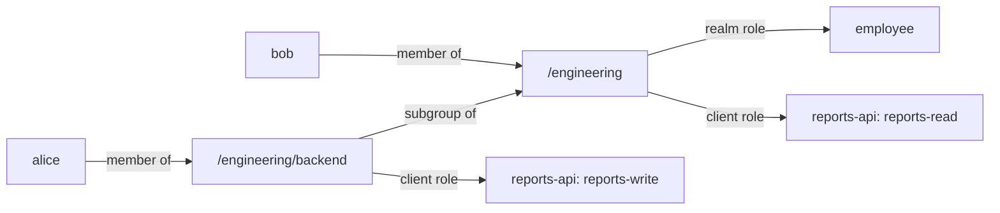

# Grant roles through groups

After this you grant realm and client roles once to a group, and give users those roles by
adding them to the group.

## When you need this

Several users need the same roles: every engineer may read reports, backend engineers may also
write them. Listing the roles under each user repeats the same block, and a new colleague means
copying it again. With groups, the roles live in one place and a user's access becomes a
one-line `groups` entry.

## What you need to know first

- **Group.** A named set of users in a realm. Roles granted to a group are effective for every
  member. See the
  [Keycloak Server Administration Guide](https://www.keycloak.org/docs/latest/server_admin/).
- **Subgroup.** A group nested in another, addressed by its path, such as
  `/engineering/backend`. A member of a subgroup also gets the roles of its parent groups
  (Keycloak behaviour, observed on 26.6.4 in the check below).
- **`realmRoles` and `clientRoles`.** The roles a group is granted. `clientRoles` maps a
  `clientId` to role names on that client. Like user roles, they are added and never removed.
  See the [Configuration reference](../configuration.md).

This is the structure the steps build:



## Steps

The names `groups`, `reports-api`, `reports-web`, `employee`, `engineering`, `backend`,
`alice` and `bob` are examples; replace them with your own. The three snippets together make
`groups.yaml`.

### 1. Declare the roles the groups grant

A group can only be granted a role that exists; a missing role fails the run. Declare the
realm role and the client with its client roles in the same realm. The provisioner creates
roles before groups, so the order in the file does not matter.

```yaml
realms:
  - realm: "groups"
    enabled: true

    roles:
      - name: "employee"
        description: "Every member of staff"

    clients:
      - clientId: "reports-api"
        publicClient: false
        secret: "${REPORTS_API_SECRET}"
        standardFlowEnabled: false
        clientRoles:
          - name: "reports-read"
          - name: "reports-write"
      - clientId: "reports-web"
        publicClient: true
        directAccessGrantsEnabled: true   # only so you can test logins with curl below
```

### 2. Declare the groups and grant them roles

`engineering` grants every member the realm role `employee` and read access. Its subgroup
`backend` adds write access only.

```yaml
    groups:
      - name: "engineering"
        realmRoles:
          - "employee"
        clientRoles:
          reports-api:
            - "reports-read"
        subGroups:
          - name: "backend"
            clientRoles:
              reports-api:
                - "reports-write"
```

### 3. Add users to the groups by path

Users carry credentials and memberships only, no roles. Groups are provisioned before users, so
a user can join a group declared in the same file.

```yaml
    users:
      - username: "alice"
        password: "${ALICE_PASSWORD}"
        enabled: true
        email: "alice@example.com"
        firstName: "Alice"
        lastName: "Example"
        groups:
          - "/engineering/backend"
      - username: "bob"
        password: "${BOB_PASSWORD}"
        enabled: true
        email: "bob@example.com"
        firstName: "Bob"
        lastName: "Example"
        groups:
          - "/engineering"
```

### 4. Run the provisioner

```console
$ REPORTS_API_SECRET='<reports-api-secret>' ALICE_PASSWORD='alice-S3cret-1' BOB_PASSWORD='bob-S3cret-1' \
  KEYCLOAK_URL=http://localhost:8080 KEYCLOAK_USER=admin KEYCLOAK_PASSWORD=<admin-password> \
  keycloak-provisioner --config groups.yaml
…
{"time":"…","level":"INFO","msg":"Creating realm role","realm":"groups","role":"employee"}
{"time":"…","level":"INFO","msg":"Creating group","realm":"groups","group":"engineering"}
{"time":"…","level":"INFO","msg":"Assigning realm roles","realm":"groups","subject":"groups","subjectName":"engineering","count":1}
{"time":"…","level":"INFO","msg":"Assigning client roles","realm":"groups","subject":"groups","subjectName":"engineering","client":"reports-api","count":1}
{"time":"…","level":"INFO","msg":"Creating subgroup","realm":"groups","group":"backend","parent":"4337e003-edd8-474f-8f2a-1709d6b66ed7"}
{"time":"…","level":"INFO","msg":"Assigning client roles","realm":"groups","subject":"groups","subjectName":"backend","client":"reports-api","count":1}
{"time":"…","level":"INFO","msg":"Creating user","realm":"groups","username":"alice"}
{"time":"…","level":"INFO","msg":"Setting user password","realm":"groups","username":"alice"}
{"time":"…","level":"INFO","msg":"Adding user to group","realm":"groups","username":"alice","group":"/engineering/backend"}
{"time":"…","level":"INFO","msg":"Creating user","realm":"groups","username":"bob"}
{"time":"…","level":"INFO","msg":"Setting user password","realm":"groups","username":"bob"}
{"time":"…","level":"INFO","msg":"Adding user to group","realm":"groups","username":"bob","group":"/engineering"}
{"time":"…","level":"INFO","msg":"Provisioning complete"}
{"time":"…","level":"INFO","msg":"keycloak-provisioner finished successfully"}
```

## Check that it works

Sign in as each user and decode the access token's payload. The `jq` filter turns the token's
base64url-encoded middle part back into JSON (tested with jq 1.8.2). Run this against a test
realm only; the password grant must be enabled on the client.

```console
$ for user in alice bob; do
    curl -s -d client_id=reports-web -d username=$user -d "password=$user-S3cret-1" \
      -d grant_type=password \
      http://localhost:8080/realms/groups/protocol/openid-connect/token \
    | jq -r .access_token \
    | jq -R 'split(".")[1] | gsub("-";"+") | gsub("_";"/") | @base64d | fromjson
             | {preferred_username, realm_roles: .realm_access.roles,
                reports_api: .resource_access["reports-api"].roles}'
  done
{
  "preferred_username": "alice",
  "realm_roles": [
    "offline_access",
    "default-roles-groups",
    "uma_authorization",
    "employee"
  ],
  "reports_api": [
    "reports-write",
    "reports-read"
  ]
}
{
  "preferred_username": "bob",
  "realm_roles": [
    "offline_access",
    "default-roles-groups",
    "uma_authorization",
    "employee"
  ],
  "reports_api": [
    "reports-read"
  ]
}
```

`alice` holds `employee` and `reports-read` from `engineering` and `reports-write` from
`backend`; `bob` holds only what `engineering` grants. Neither user has a role mapped directly.
The admin API shows the difference between direct and effective roles
(`$ADMIN_TOKEN` as in [Provision users with passwords, roles and groups](provision-users.md)):

```console
$ KC=http://localhost:8080/admin/realms/groups
$ USER_ID=$(curl -s -H "Authorization: Bearer $ADMIN_TOKEN" "$KC/users?username=alice&exact=true" | jq -r '.[0].id')
$ CLIENT_UUID=$(curl -s -H "Authorization: Bearer $ADMIN_TOKEN" "$KC/clients?clientId=reports-api" | jq -r '.[0].id')
$ curl -s -H "Authorization: Bearer $ADMIN_TOKEN" "$KC/users/$USER_ID/role-mappings/clients/$CLIENT_UUID" | jq -c '[.[].name]'
[]
$ curl -s -H "Authorization: Bearer $ADMIN_TOKEN" "$KC/users/$USER_ID/role-mappings/clients/$CLIENT_UUID/composite" | jq -c '[.[].name]|sort'
["reports-read","reports-write"]
$ curl -s -H "Authorization: Bearer $ADMIN_TOKEN" "$KC/group-by-path/engineering/backend" | jq -c '{path, realmRoles, clientRoles}'
{"path":"/engineering/backend","realmRoles":[],"clientRoles":{"reports-api":["reports-write"]}}
```

## Pitfalls

- **A misspelled role stops the run.** Groups that come before it are already written, and the
  run exits with code 1:
  `{"level":"ERROR","msg":"Provisioning failed","error":"provisioning realm \"groups\": ensuring group \"engineering\": roles for group \"engineering\": realm role \"employe\" not found in realm \"groups\""}`.
- **A misspelled group path in `users[].groups` is only a warning.** The run continues and the
  user gets none of the group's roles: `Group not found, skipping membership`. Search the log
  for `WARN` after a run.
- **Removing a role from a group, or a user from a group, changes nothing in Keycloak.** Role
  mappings and memberships are only ever added. Remove them in the admin console or through the
  admin API.
- **Renaming a group creates a second group.** Groups are matched by `name` at their level, so
  the new name is a new group and the old one stays, with its members and roles.
- **`strategy: create` still grants roles.** It only skips updating an existing group's own
  attributes; role mappings and subgroups are reconciled on every run.
- **Organization groups cannot carry roles.** `realmRoles` and `clientRoles` under an
  organization's `groups` are rejected when the config loads. Use a realm group as shown here,
  or see [Onboard an organization](onboard-an-organization.md).

## Further reading

- [Configuration reference](../configuration.md) for every group field.
- [Provision users with passwords, roles and groups](provision-users.md) for the user side.
- [How it works](../concepts.md) for the provisioning order and why nothing is removed.
- [Groups](https://www.keycloak.org/docs/latest/server_admin/) in the Keycloak Server
  Administration Guide.
