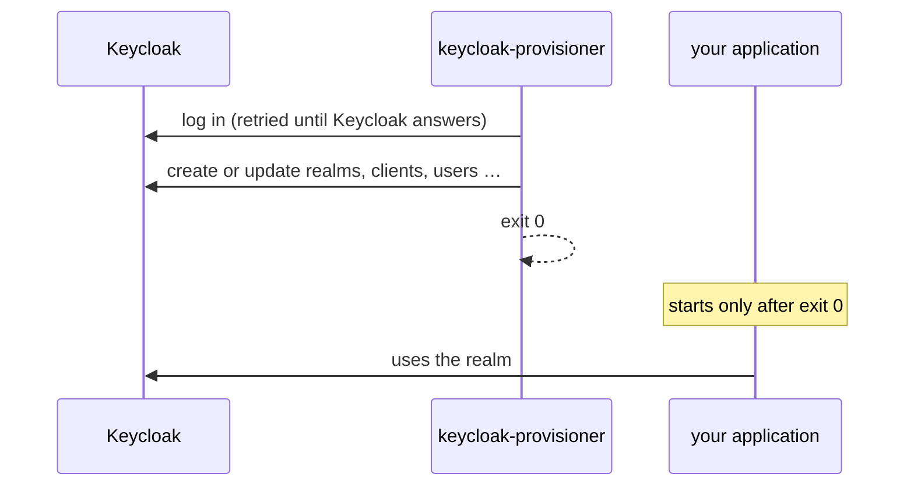

# Run the provisioner as an init container

After this your application only starts once the provisioner has brought Keycloak in line
with your config, in Docker Compose or in Kubernetes.

## When you need this

Your application expects its realm, clients and roles to exist when it starts: it fetches the
realm's OpenID Connect discovery document, or logs in with a client secret. If the
application starts first, or starts after a provisioning run that failed, it fails in ways
that are hard to trace back. Running the provisioner as a step that has to succeed before
the application starts turns a provisioning problem into one clear failed step.

## What you need to know first

- **The provisioner is a one-shot process.** It logs in, applies the config and exits with
  `0` on success and non-zero on any error. Exit codes and logs are in
  [Deployment](../deployment.md).
- **Re-running is safe.** It creates what is missing and updates what exists, and deletes
  nothing, so it can run on every start. See [How it works](../concepts.md).
- **It waits for Keycloak.** It retries the login for up to 5 minutes, so it may start before
  Keycloak is ready. See [Connection retry](../deployment.md).
- **Init container.** In Docker Compose, a service the application `depends_on` with
  `condition: service_completed_successfully`; in Kubernetes, an entry under
  `initContainers` of the pod. Both start the application only after that container exited
  with `0` (Docker Compose and Kubernetes behaviour; see
  [Compose `depends_on`](https://docs.docker.com/reference/compose-file/services/#depends_on) and
  [Init containers](https://kubernetes.io/docs/concepts/workloads/pods/init-containers/)).

This is the order of events in both setups:



## Steps

The examples provision the repository's [`config.example.yaml`](../../config.example.yaml),
which reads one variable, `MY_APP_CLIENT_SECRET`. Replace `your-registry/your-app` with your
application's image.

### 1. In Docker Compose, make the application wait for the provisioner

Add the provisioner as a service, and let the application depend on it with
`service_completed_successfully`:

```yaml
services:
  keycloak:
    image: keycloak/keycloak:26.8.2-3@sha256:7e66a96e4739239070aeaf72e4c5decf0f7f682cfc725b9f7ea2b336eaba38b3
    command: ["start-dev"]
    environment:
      KC_HEALTH_ENABLED: "true"
      KC_BOOTSTRAP_ADMIN_USERNAME: admin
      KC_BOOTSTRAP_ADMIN_PASSWORD: adminpass
    ports: ["8080:8080", "9000:9000"]
    healthcheck:
      # The image ships without curl, so probe the management port with bash.
      test: ["CMD-SHELL", "{ printf 'GET /health/ready HTTP/1.1\\r\\nHost: localhost\\r\\nConnection: close\\r\\n\\r\\n' >&3; grep -q '200 OK' <&3; } 3<>/dev/tcp/localhost/9000"]
      interval: 5s
      timeout: 5s
      retries: 20

  keycloak-provisioner:
    image: ghcr.io/datarocks-ag/keycloak-provisioner:1.14
    depends_on:
      keycloak: { condition: service_healthy }
    environment:
      KEYCLOAK_USER: admin
      KEYCLOAK_PASSWORD: adminpass
      KEYCLOAK_URL: http://keycloak:8080
      KEYCLOAK_CONFIG_PATH: /config.yaml
      MY_APP_CLIENT_SECRET: my-secret-value
    volumes:
      - ./config.example.yaml:/config.yaml:ro

  app:
    image: your-registry/your-app
    depends_on:
      keycloak-provisioner:
        condition: service_completed_successfully
```

`service_healthy` on Keycloak is optional, because the provisioner retries, but it keeps
retry warnings out of the log. Leave `restart` unset on the provisioner: it is supposed to
exit, and a restart policy that brings it back keeps Compose from treating it as completed
(Docker Compose behaviour, not checked by the provisioner).

### 2. In Kubernetes, add the provisioner under `initContainers`

Store the config in a ConfigMap and the credentials in Secrets:

```console
$ kubectl create configmap my-app-keycloak-config --from-file=config.yaml=config.example.yaml
$ kubectl create secret generic keycloak-provisioner-admin \
    --from-literal=username=<admin-user> --from-literal=password=<admin-password>
$ kubectl create secret generic my-app-client --from-literal=secret=<client-secret>
```

Then add the provisioner to the application's Deployment. This manifest is an example; it
uses only the variables the provisioner reads:

```yaml
apiVersion: apps/v1
kind: Deployment
metadata:
  name: my-app
spec:
  replicas: 1
  selector:
    matchLabels: { app: my-app }
  template:
    metadata:
      labels: { app: my-app }
    spec:
      initContainers:
        - name: keycloak-provisioner
          image: ghcr.io/datarocks-ag/keycloak-provisioner:1.14
          env:
            - { name: KEYCLOAK_URL, value: "https://keycloak.example.com" }
            - name: KEYCLOAK_USER
              valueFrom: { secretKeyRef: { name: keycloak-provisioner-admin, key: username } }
            - name: KEYCLOAK_PASSWORD
              valueFrom: { secretKeyRef: { name: keycloak-provisioner-admin, key: password } }
            - name: MY_APP_CLIENT_SECRET
              valueFrom: { secretKeyRef: { name: my-app-client, key: secret } }
            - { name: KEYCLOAK_CONFIG_PATH, value: /config/config.yaml }
          volumeMounts:
            - { name: keycloak-config, mountPath: /config, readOnly: true }
      containers:
        - name: app
          image: your-registry/your-app
      volumes:
        - name: keycloak-config
          configMap: { name: my-app-keycloak-config }
```

The image is built `FROM scratch` and contains only the binary and CA certificates, so the
container can't run a shell or a wait script; it needs none.

### 3. Run one provisioner at a time

The provisioner takes no lock. Two runs that both find a resource missing both try to create
it, and the slower one fails. Captured by starting two runs against a new realm at the same
moment:

```json
{"time":"…","level":"ERROR","msg":"Provisioning failed","error":"provisioning realm \"race\": ensuring realm: unexpected status 409: {\"errorMessage\":\"Duplicate resource error\"}"}
```

The other run succeeds, and a rerun of the failed one succeeds too, because by then the realm
exists. Until then the failed init container keeps its pod from starting; the kubelet restarts
it (Kubernetes behaviour, not checked by the provisioner). With more than one replica,
run the provisioner as a Kubernetes Job before the rollout instead (see
[Deployment](../deployment.md)), or keep `replicas: 1`.

## Check that it works

In Docker Compose, start the stack and read the provisioner's log:

```console
$ docker compose up -d
$ docker compose logs keycloak-provisioner
```

A successful run ends with these two lines (captured against Keycloak 26.6.4 with
`config.example.yaml`; timestamps trimmed):

```json
{"time":"…","level":"INFO","msg":"Provisioning complete"}
{"time":"…","level":"INFO","msg":"keycloak-provisioner finished successfully"}
```

`docker compose ps -a` then lists `keycloak-provisioner` as exited with code 0, and `app`
starts only after that exit. Captured with this file and a stand-in `app` that prints a line:
the provisioner's `keycloak-provisioner finished successfully` came first, then the app's
output.

In Kubernetes, read the init container's log from the application pod:

```console
$ kubectl logs deployment/my-app -c keycloak-provisioner
```

The same two lines appear at the end. While the init container runs or fails, the pod shows
`Init:0/1` or `Init:Error` in `kubectl get pods` (Kubernetes behaviour, not captured).

## Pitfalls

- **A wrong password looks like a slow Keycloak.** The provisioner retries every failed
  login for up to 5 minutes, so the application waits that long before it fails. Look for
  `"error":"token request failed with status 400: {\"error\":\"invalid_grant\",…` in the
  first `Keycloak not ready, retrying` warning.
- **The application never starts in Compose** when the provisioner exits non-zero; the last
  `ERROR` line of `docker compose logs keycloak-provisioner` names the cause.
- **`restart: always` or `restart: unless-stopped` on the provisioner** restarts it after it
  exits, so the application may never see it as completed (Docker Compose behaviour).
- **An unset `${VAR}` is not an error.** The config keeps the literal text `${VAR}`, which
  can end up as a client secret. See
  [Keep secrets out of the config file](keep-secrets-out-of-the-config.md).
- **Overlapping runs:** several replicas, or a Job and an init container at the same time,
  can collide as shown in step 3.

## Further reading

- [Deployment](../deployment.md): image tags, environment variables, exit codes, the Job
  manifest.
- [Preview changes with a dry run](preview-changes-with-dry-run.md) before changing the
  config of a running system.
- [Provision with a dedicated admin account](use-a-dedicated-admin-account.md) instead of the
  bootstrap administrator.
- [Kubernetes init containers](https://kubernetes.io/docs/concepts/workloads/pods/init-containers/)
  and [Compose `depends_on`](https://docs.docker.com/reference/compose-file/services/#depends_on).
