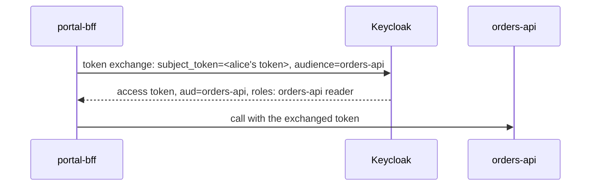

# Let a client exchange tokens for another audience

After this you have a confidential client that trades a user's access token for a token
addressed to one named downstream API, carrying only that API's roles.

## When you need this

A backend-for-frontend (BFF) holds the signed-in user's access token and calls an orders API
on the user's behalf. The orders API should accept only tokens issued for it, with the user's
orders roles and nothing else. Forwarding the user's own token sends every role the user holds
to every service. Token exchange lets the BFF ask Keycloak for a narrower token per call.

## What you need to know first

- **Standard token exchange.** The OAuth 2.0 Token Exchange grant (RFC 8693,
  `grant_type=urn:ietf:params:oauth:grant-type:token-exchange`): a client sends a token it holds
  and gets back a token for another audience. Keycloak supports it from 26.2 behind the
  `TOKEN_EXCHANGE_STANDARD_V2` server feature, which 26.6.4 reports as enabled by default. See
  [Token exchange](https://www.keycloak.org/securing-apps/token-exchange) in the Keycloak docs.
- **`standardTokenExchangeEnabled`.** Turns the grant on for the requesting client by writing
  the `standard.token.exchange.enabled` client attribute. The client must be confidential, since
  it has to authenticate at the token endpoint. See [Configuration reference](../configuration.md).
- **`fullScopeAllowed`.** With `true`, Keycloak's default for new clients, the client's tokens can
  carry every role the user holds. With `false`, a role reaches the token only when it is in the
  client's scope.
- **`scopeMappings`.** Puts named realm or client roles into the client's scope. It narrows and
  never grants: a role reaches the token only if the user holds it **and** it is in scope.
  Keycloak decides which audiences a client may request from the roles in its scope (Keycloak
  behaviour, not checked by the provisioner), so with `fullScopeAllowed: false` the scope
  mappings are also the list of reachable audiences.

This is what the exchange does with the example below:



## Steps

The names `exchange`, `orders-api`, `billing-api`, `portal-bff` and `alice` are examples;
replace them with your own. The three snippets together make `exchange.yaml`.

### 1. Declare the downstream APIs and their roles

Each API the BFF may call is a client with the client roles it checks. `billing-api` is there
to show that a client the BFF has no scope on stays out of reach.

```yaml
realms:
  - realm: "exchange"
    enabled: true
    clients:
      - clientId: "orders-api"
        bearerOnly: true
        clientRoles:
          - name: "reader"
      - clientId: "billing-api"
        bearerOnly: true
        clientRoles:
          - name: "reader"
```

### 2. Declare the requesting client with exchange on and a narrow scope

The BFF is confidential, enables the exchange, turns off full scope, and puts exactly the
roles of the APIs it may reach into its scope.

```yaml
      - clientId: "portal-bff"
        publicClient: false
        secret: "${PORTAL_BFF_SECRET}"
        directAccessGrantsEnabled: true   # only so the check below can get a user token with curl
        standardTokenExchangeEnabled: true
        fullScopeAllowed: false
        scopeMappings:
          clients:
            orders-api:                   # clientId of the client that owns the roles
              - "reader"
```

Declare `fullScopeAllowed: false` explicitly. Left out, a client the provisioner creates gets
Keycloak's permissive `true`. In production the BFF gets the user's token from a browser login,
so leave `directAccessGrantsEnabled` out there.

The provisioner applies scope mappings after all clients and realm roles exist, so the order of
clients in the file does not matter. A role named in `scopeMappings` that does not exist fails
the run.

### 3. Declare a user to test with

`alice` holds `reader` on both APIs. Only the scope mapping keeps `billing-api` out of the
BFF's tokens.

```yaml
    users:
      - username: "alice"
        enabled: true
        password: "${ALICE_PASSWORD}"
        email: "alice@example.com"
        emailVerified: true
        firstName: "Alice"
        lastName: "Example"
        roles:
          clients:
            orders-api:
              - "reader"
            billing-api:
              - "reader"
```

### 4. Run the provisioner

```console
$ PORTAL_BFF_SECRET=… ALICE_PASSWORD=… \
  KEYCLOAK_URL=http://localhost:8080 KEYCLOAK_USER=admin KEYCLOAK_PASSWORD=… \
  keycloak-provisioner --config exchange.yaml
…
{"time":"…","level":"INFO","msg":"Detected Keycloak version","version":"26.6.4"}
{"time":"…","level":"INFO","msg":"Starting provisioning"}
{"time":"…","level":"INFO","msg":"Creating realm","realm":"exchange"}
{"time":"…","level":"INFO","msg":"Creating client","realm":"exchange","clientId":"orders-api"}
{"time":"…","level":"INFO","msg":"Creating client role","realm":"exchange","clientUUID":"e8568e1f-…","role":"reader"}
{"time":"…","level":"INFO","msg":"Creating client","realm":"exchange","clientId":"billing-api"}
{"time":"…","level":"INFO","msg":"Creating client role","realm":"exchange","clientUUID":"f8ef3d07-…","role":"reader"}
{"time":"…","level":"INFO","msg":"Creating client","realm":"exchange","clientId":"portal-bff"}
{"time":"…","level":"INFO","msg":"Adding client roles to scope","realm":"exchange","owner":"clients","ownerName":"portal-bff","client":"orders-api","count":1}
{"time":"…","level":"INFO","msg":"Creating user","realm":"exchange","username":"alice"}
{"time":"…","level":"INFO","msg":"Setting user password","realm":"exchange","username":"alice"}
{"time":"…","level":"INFO","msg":"Assigning client roles","realm":"exchange","subject":"users","subjectName":"alice","client":"billing-api","count":1}
{"time":"…","level":"INFO","msg":"Assigning client roles","realm":"exchange","subject":"users","subjectName":"alice","client":"orders-api","count":1}
{"time":"…","level":"INFO","msg":"Provisioning complete"}
{"time":"…","level":"INFO","msg":"keycloak-provisioner finished successfully"}
```

Before writing anything, the provisioner checks the server: a client with
`standardTokenExchangeEnabled: true` is refused on Keycloak older than 26.2 or with
`TOKEN_EXCHANGE_STANDARD_V2` disabled, and the run fails with
`Keycloak compatibility check failed` naming the feature. See [Deployment](../deployment.md)
for the compatibility table.

## Check that it works

Run these against a test realm; they use alice's password. Get a token for alice, then
exchange it for `orders-api`:

```console
$ KC=http://localhost:8080/realms/exchange/protocol/openid-connect/token
$ SUBJECT=$(curl -s $KC -d grant_type=password -d client_id=portal-bff \
    -d client_secret=$PORTAL_BFF_SECRET -d username=alice -d password=$ALICE_PASSWORD \
    | jq -r .access_token)
$ curl -s $KC \
    -d grant_type=urn:ietf:params:oauth:grant-type:token-exchange \
    -d client_id=portal-bff -d client_secret=$PORTAL_BFF_SECRET \
    --data-urlencode subject_token=$SUBJECT \
    -d subject_token_type=urn:ietf:params:oauth:token-type:access_token \
    -d audience=orders-api | tee exchanged.json | jq 'del(.access_token)'
{
  "expires_in": 300,
  "refresh_expires_in": 0,
  "token_type": "Bearer",
  "not-before-policy": 0,
  "session_state": "kfAuHSSKgbVNfMynobckQo9L",
  "scope": "profile email",
  "issued_token_type": "urn:ietf:params:oauth:token-type:access_token"
}
```

Decode the exchanged token. It is addressed to `orders-api` only and carries only that API's
role:

```console
$ jq -r .access_token exchanged.json | cut -d. -f2 | tr '_-' '/+' | base64 -d 2>/dev/null \
    | jq '{aud, azp, preferred_username, resource_access}'
{
  "aud": "orders-api",
  "azp": "portal-bff",
  "preferred_username": "alice",
  "resource_access": {
    "orders-api": {
      "roles": [
        "reader"
      ]
    }
  }
}
```

Now ask for `billing-api`, which has no roles in the BFF's scope. Keycloak refuses, although
alice holds `billing-api`'s `reader` role:

```console
$ curl -s $KC \
    -d grant_type=urn:ietf:params:oauth:grant-type:token-exchange \
    -d client_id=portal-bff -d client_secret=$PORTAL_BFF_SECRET \
    --data-urlencode subject_token=$SUBJECT \
    -d subject_token_type=urn:ietf:params:oauth:token-type:access_token \
    -d audience=billing-api
{"error":"invalid_request","error_description":"Requested audience not available: billing-api"}
```

The same error for an audience you **do** want means its roles are missing from
`scopeMappings`. Observed on Keycloak 26.6.4 (2026-11-15).

## Pitfalls

- **Public clients are rejected at load.** `publicClient: true` with
  `standardTokenExchangeEnabled: true` stops the run before it connects:

  ```
  {"time":"…","level":"ERROR","msg":"Failed to load configuration","error":"validating config: realms[0].clients[0].standardTokenExchangeEnabled: requires a confidential client (publicClient must be false)"}
  ```

  `bearerOnly: true` is rejected the same way.
- **`strategy: create` does not correct drift.** Under `create`, an existing client is skipped,
  so a changed `standardTokenExchangeEnabled` or `fullScopeAllowed` is not written. Scope
  mappings are still added. See [How it works](../concepts.md).
- **Scope mappings only grow.** A role already in scope is left alone, and one in scope on the
  server but missing from the config is never removed. To narrow a client that has too much in
  scope, remove the mapping in Keycloak.
- **`standardTokenExchangeEnabled: false` writes `false`.** Leaving the field out leaves the
  attribute as it is on the server.
- **Impersonation is a different exchange.** Acting as another user (`requested_subject`) is
  not part of standard token exchange (Keycloak behaviour, not checked by the provisioner). See
  [Allow a client to impersonate users](allow-impersonation.md).

## Further reading

- [Configuration reference](../configuration.md) for `standardTokenExchangeEnabled`,
  `fullScopeAllowed` and `scopeMappings`, including scope mappings on a client scope.
- [Add claims and audiences with client scopes](add-claims-with-client-scopes.md).
- [Token exchange](https://www.keycloak.org/securing-apps/token-exchange) in the Keycloak docs.
